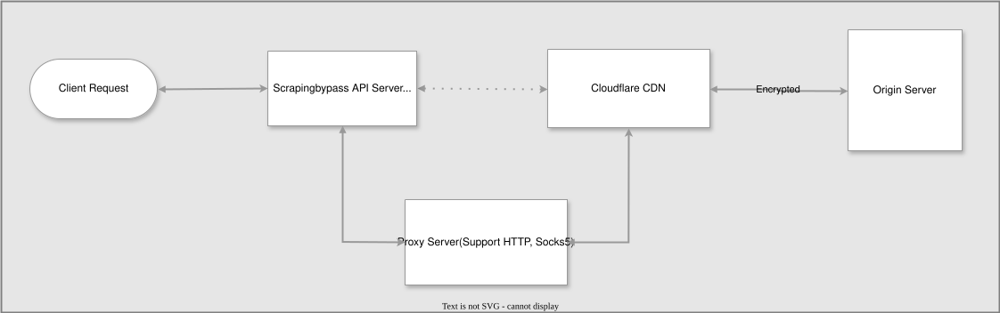

# Quick Start

Make one request, then add an SDK or challenge handling as needed. For AI-assisted integration, start with [Vibe Coding](/us-en/vibe_coding).

## Get API Key

Get an API key from the [console](https://console.scrapingbypass.com/#/api/) and configure the `CLOUDBYPASS_APIKEY` environment variable. Keep credentials out of your source repository.

Need to try the service first? See [Get a trial](/us-en/trial). Requests and challenges may consume credits; review [credit consumption](/us-en/credit_consume).

## Choose a Version

| Scenario | Version | Proxy requirement |
| --- | --- | --- |
| Works in a browser but returns 403 in code | V1 (default) | Built-in dynamic proxy |
| JS Challenge, Turnstile, or DataDome | V2 | Your sticky or fixed-IP proxy is required |
| Streaming or large downloads | V2s | Same as V2 |

The example below demonstrates URL conversion with V1. If the target requires a challenge, configure V2 using [Versions and Challenges](/us-en/challenges) instead of repeating the same request.

## Make Your First Request

This example requests `https://example.com/`. Set the environment variable before running it. When changing targets, update both `x-cb-host` and the URL path and query string.

**Bash / macOS / Linux**

```bash
curl -i "https://api.scrapingbypass.com/" \
  -H "x-cb-apikey: ${CLOUDBYPASS_APIKEY}" \
  -H "x-cb-host: example.com"
```

**Windows PowerShell**

```powershell
curl.exe -i "https://api.scrapingbypass.com/" `
  -H "x-cb-apikey: $env:CLOUDBYPASS_APIKEY" `
  -H "x-cb-host: example.com"
```

Replace only the original scheme and host with `https://api.scrapingbypass.com`. Preserve the path, query string, method, and body. For an HTTP target, also set `x-cb-protocol: http`. See [Request Parameters](/us-en/request_parameters) for the full configuration.

## Check the Result

1. Check `x-cb-status`: `ok` indicates a successful API request; the body contains the target response.
2. Check the target HTTP status and business content to confirm the expected result.
3. Otherwise, read the JSON `id`, `code`, and `message` and consult [Error Codes](/us-en/response_data?id=error-code).

## Code Examples

- SDKs: [Python](/us-en/python_sdk) · [Node.js](/us-en/nodejs_sdk) · [Go](/us-en/golang_sdk)
- AI-assisted integration: [Vibe Coding](/us-en/vibe_coding)
- Existing proxy clients: [Local Proxy Tool](/us-en/proxy_tools)
- Complete examples: [Example repository](https://github.com/cloudbypass/example)

## Accessibility Test

Use the console's [Code Generator](https://console.scrapingbypass.com/#/code-generator) to test a target website and generate a request.

## Workflow

Client → Scrapingbypass HTTP API → Target website. SDKs and proxy tools also forward requests through the HTTP API.



## Vibe Coding

See the [Vibe Coding guide](/us-en/vibe_coding) for prompts and configuration.

## Use in OpenClaw

Environment variables and proxy setup are covered in the [Vibe Coding guide](/us-en/vibe_coding).
