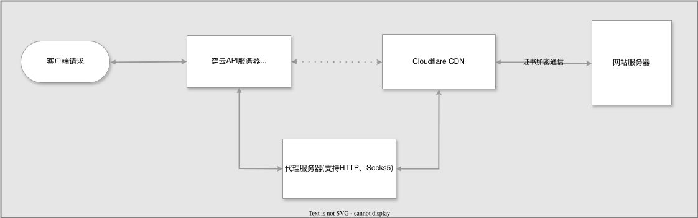

# 快速开始

完成一次请求，再按需接入 SDK 或挑战处理。已有项目需要 AI 协助？直接阅读 [Vibe Coding 指南](/zh-cn/vibe_coding)。

## 获取APIKEY

在[控制台](https://console.cloudbypass.com/#/api/)注册并获取 API Key，将它配置为环境变量 `CLOUDBYPASS_APIKEY`。请勿将密钥提交到代码仓库。

需要先体验服务？查看[领取试用](/zh-cn/trial)。请求及挑战可能消耗积分，详见[计费说明](/zh-cn/credit_consume)。

## 选择版本

| 使用场景 | 版本 | 代理要求 |
| --- | --- | --- |
| 浏览器能访问，程序请求返回 403 | V1（默认） | 默认自带动态代理 |
| JS 质询、Turnstile 或 DataDome | V2 | 必须提供粘性或固定 IP 代理 |
| 需要流式响应或下载大文件 | V2s | 与 V2 相同 |

下面先演示默认 V1 的请求转换。遇到挑战时，按[版本与挑战处理](/zh-cn/challenges)配置 V2；不要仅重复请求。

## 发起首次请求

以下示例访问 `https://example.com/`。运行前配置环境变量；替换目标时，同时修改 `x-cb-host` 和 URL 的路径、查询参数。

**Bash / macOS / Linux**

```bash
curl -i "https://api.cloudbypass.com/" \
  -H "x-cb-apikey: ${CLOUDBYPASS_APIKEY}" \
  -H "x-cb-host: example.com"
```

**Windows PowerShell**

```powershell
curl.exe -i "https://api.cloudbypass.com/" `
  -H "x-cb-apikey: $env:CLOUDBYPASS_APIKEY" `
  -H "x-cb-host: example.com"
```

转换规则：只将原 URL 的协议和主机替换成 `https://api.cloudbypass.com`，保留路径、查询、方法及请求体。原目标使用 HTTP 时，额外设置 `x-cb-protocol: http`。完整配置见[请求参数](/zh-cn/request_parameters)。

## 检查请求结果

1. 查看响应头 `x-cb-status`：`ok` 表示穿云请求成功，响应体为目标站内容。
2. 再检查目标 HTTP 状态码和业务内容，确认得到预期结果。
3. `x-cb-status` 非 `ok` 时，读取 JSON 中的 `id`、`code`、`message`，根据[错误代码](/zh-cn/response_data)定位问题。

## 代码示例

- 使用 SDK：[Python](/zh-cn/python_sdk) · [Node.js](/zh-cn/nodejs_sdk) · [Go](/zh-cn/golang_sdk)
- 让 AI 帮助接入：[Vibe Coding](/zh-cn/vibe_coding)
- 在现有代理客户端中使用：[本地代理工具](/zh-cn/proxy_tools)
- 更多完整项目：[公开代码示例](https://github.com/cloudbypass/example)

## 可访问性测试

用控制台的[代码生成器](https://console.cloudbypass.com/#/code-generator)测试目标网站，并生成对应请求。

## 工作流程

客户端 → 穿云 HTTP API → 目标网站。SDK 与代理工具也通过 HTTP API 转发请求。



## 在OpenClaw中使用

环境变量、代理选择和 AI 提示词统一见 [Vibe Coding 指南](/zh-cn/vibe_coding)。
